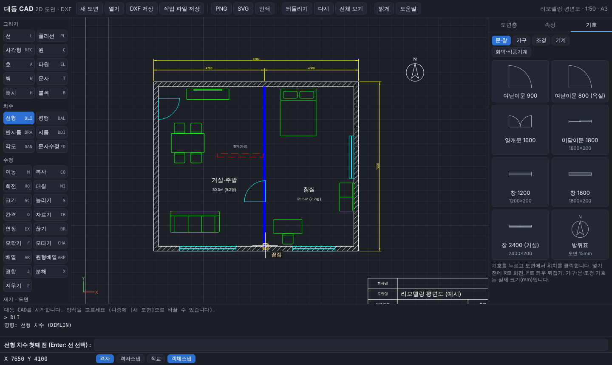
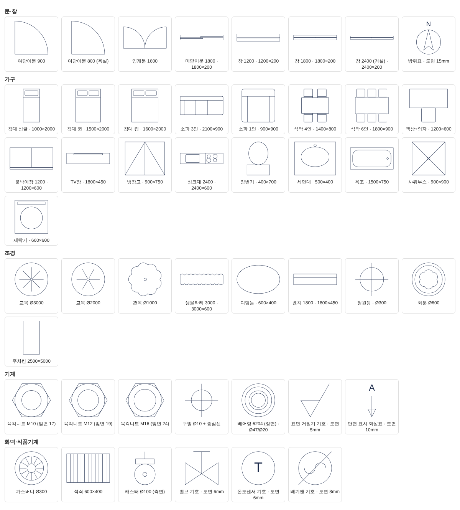

# 대동 CAD: 2D 도면 프로그램 (DXF)

대동 건설·외식 장비 일에 쓰는 **2D 도면 프로그램**입니다. 웹 브라우저(크롬·엣지)에서 열리고, 설치나 인터넷이 필요 없습니다. 도면은 **DXF**로 저장하므로 오토캐드 등 대부분의 CAD 프로그램과 주고받을 수 있습니다.

- 만든 날: 2026-10-29 · 1.0.0, 고친 날: 2026-10-30 · **1.1.0** (해치, 블록 만들기, 늘리기, 끊기 등. 맨 아래 '바뀐 기록')
- 바로 쓰는 파일: [`dist/daedong-cad.html`](dist/daedong-cad.html) 한 파일입니다. PC에 저장하고 두 번 클릭하면 열립니다.
- 예시 도면: [`docs/sample-remodel.dxf`](docs/sample-remodel.dxf)(DXF), [`docs/sample-remodel.dcad.json`](docs/sample-remodel.dcad.json)(작업 파일)

## 1. 어떻게 만들었나 (중요)

- **오토캐드를 분석하거나 베끼지 않았습니다.** 오토캐드의 프로그램 파일은 보지도 열지도 않았습니다. 다음 세 가지만으로 새로 설계했습니다.
  - Autodesk가 공개한 DXF 파일 형식
  - 선·원·간격띄우기·자르기처럼 CAD 프로그램이 공통으로 쓰는 일반 기능과 관례
  - 대동의 실제 도면 종류(리모델링·가구·조경·차량부품·건설기계·화덕/식품기계)
- 2026-10-29 대표님이 "REA로 오토캐드 구조를 분석해 똑같이 만들자"고 하셨을 때, 법무팀 이사로서 위 방식을 권해 정한 것입니다.
  - 【법령】 저작권법 제101조의4(프로그램코드역분석)는 기억하는 요지로, 호환에 필요한 정보만 얻는 범위에서 역분석을 허용하고, 그 정보로 비슷한 프로그램을 만드는 데 쓰는 것은 막습니다. 원문은 아직 대조하지 못했습니다 [확인 필요]. 오토캐드 이용 약관도 역분석을 금지할 가능성이 큽니다 [확인 필요].
  - 앞으로 기능을 더할 때도 이 원칙을 지킵니다. 다른 CAD의 내부 코드·화면·아이콘을 가져오지 않습니다.
- 명령 이름과 단축 글자(L=선, C=원 등)는 여러 CAD에서 흔히 쓰는 관례를 따랐습니다. 기호(가구·문·나무 등)와 표제란은 이번에 새로 그렸습니다.

## 2. 여는 법

1. `dist/daedong-cad.html`을 PC에 저장하고 두 번 클릭합니다. 크롬이나 엣지를 권합니다.
2. 처음 열면 **새 도면** 창이 뜹니다. 양식, 종이 크기, 축척을 고르고 [만들기]를 누릅니다.
3. 작업은 브라우저에 자동 저장되어, 다시 열면 이어서 나옵니다. 다만 브라우저 기록을 지우면 사라질 수 있으니 **작업 파일 저장**으로 파일을 꼭 남겨 두세요.

개발용으로는 이 폴더의 `index.html`을 직접 열어도 됩니다. 이 경우 `js/`·`css/` 폴더가 함께 있어야 합니다.

## 3. 도면 양식 6종

새 도면을 만들 때 고르면 도면층(색·선 종류), 문자·치수 크기, 격자, 도곽·표제란이 맞춰집니다.

| 양식 | 기본 축척·종이 | 도면층 |
|---|---|---|
| 리모델링 평면도 | 1:50 · A3 | 벽체, 기존벽, 철거(파선), 신설벽, 문창, 가구, 위생설비, 전기, 치수, 문자, 중심선, 표제란 |
| 가구 배치도 | 1:50 · A3 | 벽체, 문창, 가구-거실·침실·주방·욕실·신규, 치수, 문자, 중심선, 표제란 |
| 조경 배치도 | 1:100 · A3 | 대지경계(가상선), 건물, 포장, 잔디, 수목-교목·관목, 수경, 시설물, 치수, 문자, 표제란 |
| 차량부품 설계도 | 1:1 · A3 (치수 소수 1자리) | 외형선, 숨은선, 중심선, 가상선, 단면, 치수, 문자, 표제란 |
| 건설기계 설계도 | 1:10 · A2 | (차량부품과 같음) |
| 화덕·식품기계 설계도 | 1:5 · A3 | 외형선, 숨은선, 중심선, 단열재, 배관-가스(일점쇄선), 배관-물·스팀, 전기, 치수, 문자, 표제란 |

- 그림은 **언제나 실제 크기(mm)** 로 그립니다. 축척은 문자·치수 크기와 인쇄할 때만 씁니다.
- 축척을 나중에 바꾸려면 아무것도 고르지 않은 상태에서 오른쪽 [속성]의 '축척 1:'을 고칩니다.
- 표제란은 보통 문자라서 두 번 클릭하면 고칠 수 있습니다. 칸은 회사명, 도면명, 도면번호, 축척, 작성일, 단위, 작성, 검토입니다.

## 4. 기능

| 묶음 | 명령 (명령줄 입력) |
|---|---|
| 그리기 | 선 `L`, 폴리선 `PL`(호 구간 `A`), 사각형 `REC`, 원 `C`(세 점 `3P`·두 점 `2P`·지름 `D`), 호 `A`, 타원 `EL`, **벽** `W`(두께 지정, 닫으면 안·밖 두 줄), 문자 `T`, **해치** `H`, **블록 만들기** `B` |
| 치수 | 선형 `DLI`(가로·세로 자동), 평행 `DAL`, 반지름 `DRA`, 지름 `DDI`, 각도 `DAN`, 문자 고치기 `ED` |
| 수정 | 이동 `M`, 복사 `CO`, 회전 `RO`, 대칭 `MI`, 크기 `SC`(참조 길이 `R`), **늘리기** `S`, 간격띄우기 `O`(호 구간 폴리선 포함), 자르기 `TR`, 연장 `EX`(선·호), **끊기** `BR`, 모깎기 `F`, 모따기 `CHA`, 배열 `AR`, 원형배열 `ARP`, 결합 `J`, 분해 `X`, 지우기 `E` |
| 재기 | 거리 `DI`, **넓이** `AA`(m²와 평, 1평 = 3.305785 m²) |
| 도면 | 도곽·표제란 `도곽`, 기호 넣기(오른쪽 [기호] 탭), 전체 보기 `Z` |

- **해치(채우기)** `H`: 채울 곳 안쪽을 클릭합니다.
  - 그 점을 둘러싼 가장 작은 닫힌 폴리선·원·타원이 경계가 되고, 바로 안쪽의 닫힌 객체는 구멍(섬)으로 비웁니다. 벽 두 줄 사이를 클릭하면 벽만, 방 안을 클릭하면 방 바닥만 채워지고 방 안의 가구는 비워집니다.
  - 경계를 직접 고르려면 `B`, 무늬는 `P`, 축척은 `S`, 각도는 `A`입니다.
  - 무늬 11가지: 채우기(단색), 사선(단면), 역사선, 격자, 사선 격자, 단열재, 벽돌, 타일, 잔디, 점(자갈·모래), 물·수경
  - 무늬 간격은 도면 축척에 맞춰집니다(1:50이면 종이에서 3mm 간격). 넣은 뒤에도 [속성]에서 무늬·축척·각도를 바꿀 수 있고, 넓이(㎡·평)도 보입니다.
  - 해치는 다른 객체 뒤에 그려집니다. 선으로만 그린 테두리는 결합(`J`)으로 닫힌 폴리선을 만든 뒤 채우세요.
- **블록 만들기** `B`: 고른 객체를 블록(내 기호) 하나로 묶습니다. 이름을 정하면 [기호] 탭의 '이 도면의 블록'에서 다시 넣을 수 있습니다.
- **늘리기** `S`: 창으로 감싼 끝점만 옮깁니다. 벽을 1m 늘리면 그 벽의 해치와 치수도 함께 늘어납니다. 창에 끝이 다 들어간 객체는 통째로 옮겨집니다.
- **끊기** `BR`: 객체를 클릭한 곳부터 둘째 점까지 지웁니다. 둘째 점에 `@`를 치면 그 자리에서 둘로 나눕니다. `F`로 첫 점을 다시 찍을 수 있고, 원은 첫 점에서 반시계로 지웁니다.
- 한글 명령도 됩니다(`선`, `원`, `벽`, `넓이`, `해치`, `늘리기` 등). 빈 Enter나 오른쪽 클릭은 끝내기이고, 명령이 없을 때는 직전 명령을 다시 합니다. Esc는 취소입니다.
- 좌표는 이렇게 입력합니다.
  - `1200,800`: 절대 좌표
  - `@3000,0`: 앞 점에서 상대 좌표
  - `@1500<45`: 앞 점에서 거리와 각도
  - 숫자만 치면 커서 방향으로 그 거리만큼 갑니다. 직교(F8)를 켜고 쓰면 편합니다.
  - 식도 됩니다: `3000/2`, `900+200`
- 스냅과 보조 기능
  - 객체스냅(F3): 끝점, 중간점, 중심, 사분점, 교차점, 삽입점, 수직점, 근처점. 객체스냅 버튼을 오른쪽 클릭하면 종류를 고릅니다.
  - 격자(F7), 격자스냅(F9), 직교(F8)
- 선택: 클릭하면 하나씩 더합니다. Shift+클릭은 빼기입니다.
  - 왼쪽→오른쪽으로 끌면 창 안에 다 든 것만, 오른쪽→왼쪽으로 끌면 걸친 것까지 고릅니다.
  - Ctrl+A는 전체, Delete는 지우기입니다.
  - 고른 객체의 파란 네모(그립)를 클릭하면 그 점을 옮깁니다.
- 보기: 휠로 확대·축소, 휠을 누른 채 끌기(또는 스페이스+끌기)로 이동, 휠 두 번 클릭은 전체 보기입니다.
- 도면층: 현재 층, 색(표준 255색), 선 종류(실선·파선·숨은선·중심선·가상선·일점쇄선·점선), 보이기, 잠그기, 이름 바꾸기
- 속성: 고른 객체의 도면층·색·선 종류와 좌표·길이·반지름·넓이·문자 등을 숫자로 바로 고칩니다.
- 되돌리기·다시(Ctrl+Z/Y, 60단계)

### 기호 47종 (실제 크기)

| 분류 | 기호 |
|---|---|
| 문·창 | 여닫이문 900·800, 양개문 1600, 미닫이문 1800, 창 1200·1800·2400, 방위표 |
| 가구 | 침대 싱글·퀸·킹, 소파 3인·1인, 식탁 4인·6인, 책상+의자, 붙박이장, TV장, 냉장고, 싱크대, 양변기, 세면대, 욕조, 샤워부스, 세탁기 |
| 조경 | 교목 Ø3000·Ø2000, 관목, 생울타리, 디딤돌, 벤치, 정원등, 화분, 주차칸 |
| 기계 | 육각너트 M10·M12·M16, 구멍+중심선, 베어링 6204, 표면 거칠기, 단면 표시 |
| 화덕·식품기계 | 가스버너 Ø300, 석쇠, 캐스터, 밸브·온도센서·배기팬 기호 |

- 넣기 전에 `R`로 회전하고 `F`로 좌우를 뒤집습니다. 방위표처럼 '도면 ○mm'라고 적힌 주석 기호는 축척을 곱해 넣습니다.
- 화덕·식품기계 기호는 시중의 일반 부품 모양일 뿐입니다. **복합 초벌 화덕 고유의 설계는 넣지 않았습니다.**

## 5. 파일과 호환

| 저장 | 내용 | 용도 |
|---|---|---|
| **DXF 저장** (Ctrl+S) | AutoCAD R12 형식의 ASCII DXF | 다른 CAD와 주고받기, 업체 전달 |
| **작업 파일 저장** | `.dcad.json` (모든 정보) | 계속 고칠 원본 보관 |
| PNG | 종이 200dpi 상당 그림 | 카톡·문서에 붙이기 |
| SVG | 벡터 그림, 종이 크기 = 실제 축척 | 문서·인쇄소 |
| 인쇄 | 도곽 범위를 흑백으로, 종이 크기 = 실제 축척 | 인쇄 설정에서 '실제 크기(100%)' |

- **DXF 저장**
  - 거의 모든 CAD가 읽는 R12 형식으로 저장합니다.
  - 한글은 `\U+XXXX`로, Ø·°·±는 `%%c`·`%%d`·`%%p`로 적습니다. 파일 안은 영문 글자(ASCII)뿐이라 글자가 깨지지 않습니다. 문자 글꼴은 맑은 고딕(`malgun.ttf`)으로 지정합니다.
  - 해치는 R12에 해치 객체가 없어서, 해치마다 블록(`DCAD_HATCH_번호`) 하나에 무늬 선이나 단색 조각(SOLID)을 담아 한 번 넣습니다. 오토캐드 등에서 해치 하나가 한 덩어리로 골라집니다.
  - 치수, 타원, 여러 줄 문자는 R12에 없거나 호환이 약해서 선·문자로 풀어 저장합니다. 다른 CAD에서 열면 모양은 같지만, 치수는 '치수 객체'가 아닌 선과 글자가 됩니다. 계속 고칠 원본은 **작업 파일**로 함께 보관하세요.
- **DXF 열기**
  - R12부터 최신(R2018 이후)까지의 ASCII DXF를 엽니다. 한글은 cp949(ANSI_949), UTF-8, `\U+` 모두 읽습니다.
  - 읽는 객체: 선, 원, 호, 폴리선(LWPOLYLINE·POLYLINE, 볼록 구간 포함), 문자, 여러 줄 문자(서식은 지움), 블록(INSERT, 속성 값, 배열 MINSERT), 치수(블록 모양 그대로), 타원, 스플라인(점열로 근사), 점, SOLID·TRACE·3DFACE, 지시선, **해치**
  - 해치는 경계(폴리선, 그리고 선·호·타원·스플라인 모서리)와 무늬 선 정의를 그대로 읽습니다. 그래서 ANSI31처럼 다른 CAD의 무늬도 같은 모양으로 보입니다. 단색과 구멍 있는 해치도 읽습니다.
  - 대칭한 객체(-Z 방향)도 바르게 놓고, 꺼진 층과 잠긴 층도 그대로 읽습니다.
  - 그라데이션 해치는 단색으로 보입니다. 읽지 못한 객체가 있으면 개수를 명령줄에 알려 줍니다. 바이너리 DXF와 DWG는 열지 못하니, DWG는 상대 CAD에서 DXF로 저장해 받으세요.
- 파일을 화면에 끌어다 놓아도 열립니다.

## 6. 확인한 것

| 확인 | 결과 |
|---|---|
| 브라우저 종단 시험 (`test/e2e.js`, Chromium) | 46개 통과 (1.1.0). 벽 넓이 21.84㎡·6.61평, **벽 사이 클릭 해치(경계 2개)·방 안 잔디 해치**, 치수 2000·1500·Ø600, 한글 문자, 자르기, 간격띄우기, 모깎기 R300, 이동, 원형 배열, 되돌리기, 끝점 스냅, 창 선택, 그립, 호 폴리선, 두 번 클릭 고치기, 분해·결합, **블록 만들기, 끊기, 호 연장(90°→120°), 늘리기(벽 6.2×4.2로, 해치 경계도 함께)**, 인쇄 준비, DXF·SVG·PNG·작업 파일 저장, 저장 파일 이름, 양식 5종, 받은 DXF 열기(해치 포함) |
| 단위 시험 (`node --test test/unit.js`) | 17개 통과 (1.1.0). 교점, 대칭 행렬, 좌표 입력, 오프셋, 넓이(호 포함), 자르기, 대칭 시 문자 방향, 치수 값, DXF 쓰고 다시 읽기, ezdxf가 만든 DXF 3종 읽기, SVG 종이 크기, **해치 무늬 길이(구멍 포함)·단색 넓이, 해치 경계 찾기(섬), 해치 DXF 읽기 5종·쓰기, 늘리기와 치수, 끊기(닫힌·호 폴리선), 호 구간 폴리선 간격띄우기(넓이 정확)** |
| **다른 프로그램이 우리 DXF를 읽는지** | ezdxf 1.4.5 감사(audit): 저장 파일 7종 모두 **오류 0** (해치 블록 7개 포함) · LibreCAD 2.2: 도곽·벽·문·치수·화살표·원·모깎기, 해치 5종(사선·단색·구멍·대칭) 모두 바르게 그림 |
| 다른 프로그램이 만든 DXF를 우리가 읽는지 | ezdxf로 만든 R12(cp949)·R2000(cp949)·R2018(UTF-8): 한글 문자·도면층·블록 이름, 대칭 호, 블록 속성, 꺼진·잠긴 층 모두 맞음. **해치 5종**(ANSI31 축척 2·30°, 시계 방향 호 모서리 경계 넓이 8827.43 정확, 원 구멍 단색, 타원·스플라인 모서리, -Z 대칭) 맞음 |

- **아직 못 한 것**
  - 오토캐드 자체에서 여는 시험은 하지 못했습니다(이 작업 환경에 없음). 대표님이나 업체 PC의 오토캐드로 `docs/sample-remodel.dxf`를 한 번 열어 봐 주세요. 한글이 맑은 고딕으로 보이는지가 확인할 점입니다 [확인 필요].
  - LibreCAD는 자체 글꼴에 한글이 없어서 한글이 네모로 보입니다. 글자 코드는 바르게 읽습니다(é·Ø·±·°로 확인). LibreCAD 쪽의 한계입니다.

## 7. 한계와 다음 할 일

- 아직 없는 기능: 레이아웃(종이 공간), 3D, DWG 직접 열기, 블록 고쳐 쓰기(지금은 분해 → 고치기 → 다시 블록)
- 해치 경계는 닫힌 폴리선·원·타원만 찾습니다. 선 여러 개로 둘러싼 곳은 결합(`J`)으로 먼저 닫아 주세요.
- 해치는 경계와 이어져 있지 않습니다. 경계만 고치면 해치는 그대로이니 늘리기(`S`)로 함께 고치거나 다시 채우세요.
- 자르기는 모든 객체를 기준으로 삼습니다(해치는 빼고). 연장은 선과 호만 됩니다.
- 쓰다가 불편한 점을 말씀해 주시면 위 순서와 관계없이 먼저 고칩니다.

## 8. 보안과 공개

- 도면은 대표님 PC의 브라우저와 대표님이 저장한 파일에만 있습니다. 프로그램이 인터넷으로 보내는 것은 없습니다.
- **복합 초벌 화덕·컨트롤러 도면은 특허 검토 전에는 SNS나 외부에 보이지 않습니다**(설계 기록 3-14, 대동그룹 설계 기록 최신본). 업체에 보낼 때는 비밀유지계약을 먼저 맺습니다.
- 매장 도면에는 1호점 후보지 주소를 임대 계약 전까지 적지 않습니다(홍보 원칙과 같음).

## 9. 폴더

| 경로 | 내용 |
|---|---|
| `index.html`, `css/`, `js/` | 프로그램 (`geom` 기하, `model` 도면 모델, `hatch` 해치, `dxf-read`·`dxf-write` DXF, `svg` 내보내기, `library` 양식·기호, `render` 화면, `commands` 명령, `app` 화면 연결, `aci` 표준 색) |
| `build.js` | `node build.js` → `dist/daedong-cad.html` (한 파일) |
| `test/` | `unit.js`, `e2e.js`, `make_fixtures.py`(ezdxf로 시험 DXF 만들기), `make-sample.js`(예시 도면·화면), `symbol-sheet.js`(기호 목록 그림), `fixtures/` |
| `docs/` | 화면, 기호 목록, 예시 도면 |

- 시험 돌리기
  - `node --test test/unit.js`
  - `node test/e2e.js <출력 폴더>` (Playwright Chromium 필요)
  - 저장된 DXF는 ezdxf `recover.readfile`의 auditor로 점검합니다.
- 표준 색표(ACI 255색)는 ezdxf(MIT)의 기본 색표에서 만들었습니다.

## 10. 바뀐 기록

| 날짜 | 판 | 내용 |
|---|---|---|
| 2026-10-29 | 1.0.0 | 첫 판: 양식 6종, 기호 47종, 명령 34개, DXF R12 저장·읽기, SVG·PNG·인쇄 |
| 2026-10-30 | 1.1.0 | 해치(무늬 11가지, 클릭으로 경계·섬 찾기, 받은 DXF의 해치 읽기, R12에는 블록으로 저장), 블록 만들기, 늘리기(치수·해치 함께), 끊기, 호 구간 폴리선 간격띄우기, 호 연장. 예시 도면에 벽 해치. 명령 38개 |
